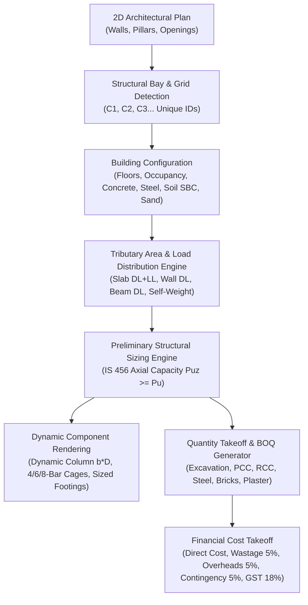

# Full Building Construction Calculation & Structural Engineering Manual

> **A Comprehensive Reference Guide for Structural Loads, Dynamic Sizing, Material Takeoff, and Construction Cost Estimation**  
> *Compliant with IS 456:2000, IS 875 (Parts 1 & 2), IS 1200, and the Full Building Construction Calculation & Formula Handbook.*

---

## Table of Contents

1. [Executive Summary & System Architecture](#1-executive-summary--system-architecture)
2. [Part 1: Brick Sizes, Mortar Joints & Nominal Dimensions](#part-1-brick-sizes-mortar-joints--nominal-dimensions)
3. [Part 2: Brick Wall Quantity Takeoff Method](#part-2-brick-wall-quantity-takeoff-method)
4. [Part 3: Door, Window & Ventilator Deductions](#part-3-door-window--ventilator-deductions)
5. [Part 4: Wall Splitting & Column Intersection Deduction](#part-4-wall-splitting--column-intersection-deduction)
6. [Part 5: Masonry Mortar Volume, Cement Bags & Sand (Dry Factor 1.33)](#part-5-masonry-mortar-volume-cement-bags--sand-dry-factor-133)
7. [Part 6: Wall & Ceiling Plastering Takeoff (IS 1200 Part XII Rules)](#part-6-wall--ceiling-plastering-takeoff-is-1200-part-xii-rules)
8. [Part 7: RCC Column Concrete & Reinforcement Detailing](#part-7-rcc-column-concrete--reinforcement-detailing)
9. [Part 8: Substructure Foundation Layers (Excavation, Sand Bed, PCC & Footings)](#part-8-substructure-foundation-layers-excavation-sand-bed-pcc--footings)
10. [Part 9: RCC Plinth & Ring Beams](#part-9-rcc-plinth--ring-beams)
11. [Part 10: Full Roof Slabs & Orthogonal Two-Way Reinforcement Meshes](#part-10-full-roof-slabs--orthogonal-two-way-reinforcement-meshes)
12. [Part 11: Steel Unit Weight Formula (db² / 162) & Physical Proof](#part-11-steel-unit-weight-formula-db--162--physical-proof)
13. [Part 12: 3D Steel View Generation & Elevation Stacking Cascade](#part-12-3d-steel-view-generation--elevation-stacking-cascade)
14. [Part 13: Building Configuration & Multi-Storey Load Accumulation (IS 875)](#part-13-building-configuration--multi-storey-load-accumulation-is-875)
15. [Part 14: Geotechnical Soil Stratum Catalog & Borehole SBC Guidance](#part-14-geotechnical-soil-stratum-catalog--borehole-sbc-guidance)
16. [Part 15: River Sand vs. M-Sand Fine Aggregate Selection & Costing](#part-15-river-sand-vs-m-sand-fine-aggregate-selection--costing)
17. [Part 16: Column Load Distribution by Tributary Area (Corner, Edge, Interior)](#part-16-column-load-distribution-by-tributary-area-corner-edge-interior)
18. [Part 17: Dynamic Column Sizing & Axial Strength Verification (IS 456 Cl. 39.3)](#part-17-dynamic-column-sizing--axial-strength-verification-is-456-cl-393)
19. [Part 18: Dynamic Rebar Detailing (4-Bar, 6-Bar, 8-Bar Cages & Confinement)](#part-18-dynamic-rebar-detailing-4-bar-6-bar-8-bar-cages--confinement)
20. [Part 19: Soil-Sized Concentric Footing Sizing & Quantity Takeoff](#part-19-soil-sized-concentric-footing-sizing--quantity-takeoff)
21. [Part 20: Whole-Building Structural Quantity Takeoff & Complete Cost Estimation](#part-20-whole-building-structural-quantity-takeoff--complete-cost-estimation)
22. [Engineering Safety & Code Disclaimer](#engineering-safety--code-disclaimer)

---

## 1. Executive Summary & System Architecture

The **Brick Factory Estimation & 3D Engineering Platform** unifies architectural 2D layout drafting, WebGL 3D hardware-accelerated rendering, structural load accumulation, preliminary member sizing, and financial bill of quantities (BOQ) calculation into a single, synchronized workflow.



---

## Part 1: Brick Sizes, Mortar Joints & Nominal Dimensions

When estimating brick masonry, calculating with raw clay dimensions alone leads to massive over-ordering errors because cement mortar occupies significant volume within finished walls.

### 1.1 Physical Solid Clay Brick
* **Standard Kiln Size**: 230 mm (Length) × 115 mm (Width) × 75 mm (Height).
* **Solid Clay Volume**: 
  $$\text{Volume}_{\text{solid}} = 0.230 \times 0.115 \times 0.075 = 0.00198375\text{ m}^3$$

### 1.2 The Mortar Joint Cushion
* Bricks are never laid clay-to-clay. A **10 mm mortar bed** is placed horizontally beneath each course, and a **10 mm head joint** is placed vertically between adjacent bricks.

### 1.3 Nominal Brick Unit Dimensions
* Adding the 10 mm joint expands each brick's occupied envelope in the wall:
  * Nominal Length: $230\text{ mm} + 10\text{ mm} = 240\text{ mm}\ (0.240\text{ m})$
  * Nominal Width: $115\text{ mm} + 10\text{ mm} = 125\text{ mm}\ (0.125\text{ m})$
  * Nominal Height: $75\text{ mm} + 10\text{ mm} = 85\text{ mm}\ (0.085\text{ m})$
* **Nominal Brick Unit Volume**:
  $$\text{Volume}_{\text{nominal}} = 0.240 \times 0.125 \times 0.085 = 0.00255\text{ m}^3$$

### 1.4 Bricks Per Cubic Meter
* **Theoretical Bricks per m³ (without mortar)**: $1 / 0.001984 \approx 504\text{ bricks/m}^3$.
* **Actual Bricks per m³ (with nominal mortar joints)**:
  $$\text{Base Bricks per m}^3 = \frac{1}{0.00255} \approx 392.15 \rightarrow 392\text{ bricks/m}^3$$
* Accounting for mortar prevents purchasing approximately 22% more bricks than can physically fit into the structure.

---

## Part 2: Brick Wall Quantity Takeoff Method

The step-by-step procedure to determine the exact number of bricks required for any wall:

1. **Calculate Gross Wall Area**: Multiply clear wall length by floor height.
   $$\text{Area}_{\text{gross}} = \text{Length} \times \text{Height}$$
2. **Calculate Gross Wall Volume**: Multiply gross area by wall thickness ($0.115\text{ m}$ for 4.5-inch partition walls, $0.230\text{ m}$ for 9-inch load-bearing walls).
   $$\text{Volume}_{\text{gross}} = \text{Area}_{\text{gross}} \times \text{Thickness}$$
3. **Subtract Openings**: Deduct all doors, windows, and structural column intersections to arrive at net masonry volume.
   $$\text{Volume}_{\text{net}} = \text{Volume}_{\text{gross}} - \text{Volume}_{\text{openings}} - \text{Volume}_{\text{columns}}$$
4. **Determine Base Brick Count**:
   $$\text{Base Bricks} = \left\lceil \frac{\text{Volume}_{\text{net}}}{0.00255} \right\rceil$$
5. **Add Wastage Allowance**: Add 5% for straight walls (or up to 8% for complex layouts) to account for cuts, batts, and site handling damage:
   $$\text{Purchase Bricks} = \lceil \text{Base Bricks} \times 1.05 \rceil$$

---

## Part 3: Door, Window & Ventilator Deductions

Openings are subtracted cleanly from the masonry volume to ensure accurate material purchases:

* **Individual Opening Area**:
  $$\text{Area}_{\text{opening}} = \text{Width}_{\text{clear}} \times \text{Height}_{\text{clear}}$$
* **Total Opening Deduction Volume**:
  $$\text{Volume}_{\text{deduction}} = \sum (\text{Area}_{\text{opening}}) \times \text{Wall Thickness}$$
* Standard doors ($3\text{ ft} \times 7\text{ ft} = 21\text{ sq.ft}$) and windows ($4\text{ ft} \times 4\text{ ft} = 16\text{ sq.ft}$) immediately drop the base brick count by their corresponding volume.

---

## Part 4: Wall Splitting & Column Intersection Deduction

In reinforced concrete framed structures, concrete pillars and brick walls cannot occupy the same physical space. If walls are calculated from building corner to building corner without deducting columns, clients pay for 8% to 15% more bricks than can physically fit.

### 4.1 Linear Column Deduction
* For every column along a wall line, the column's parallel dimension is deducted from the clear brickwork run:
  $$\text{Length}_{\text{clear masonry}} = \text{Length}_{\text{total}} - \sum \text{Column Widths}$$

### 4.2 3D Wall Splitting Algorithm (`splitWallByPillars`)
* In the 3D model, walls intersecting RCC columns are algorithmically split into sub-spans at the pillar boundary faces.
* Sub-span 1 runs from the start point to the entering pillar face. Sub-span 2 starts on the exit pillar face and continues to the end.
* This guarantees zero 3D mesh clipping and exact mathematical alignment between the 3D visual model and the material takeoff.

---

## Part 5: Masonry Mortar Volume, Cement Bags & Sand (Dry Factor 1.33)

To calculate the exact cement bags and sand required for bricklaying:

1. **Calculate Solid Clay Volume**:
   $$\text{Volume}_{\text{clay}} = \text{Base Brick Count} \times 0.00198375\text{ m}^3$$
2. **Extract Wet Mortar Volume**:
   $$\text{Volume}_{\text{wet mortar}} = \text{Volume}_{\text{net wall}} - \text{Volume}_{\text{clay}}$$
   *(Mortar typically occupies 22% to 24% of the finished brick wall).*
3. **Apply Dry Volume Shrinkage Factor (1.33)**:
   Dry cement powder and sand particles compact when water is introduced, as cement grains slip into the voids between sand particles. Thus, 1 cubic meter of wet mortar requires 1.33 cubic meters of dry ingredients:
   $$\text{Volume}_{\text{dry mortar}} = \text{Volume}_{\text{wet mortar}} \times 1.33$$
4. **Determine Component Parts (1:5 Mortar Mix)**:
   Total parts = $1 + 5 = 6\text{ parts}$.
   * **Cement Volume**: $\text{Volume}_{\text{dry mortar}} / 6$.
   * **Cement Bags (50 kg)**: Divided by $0.0347\text{ m}^3$ per 50 kg bag (or multiplied by $1440\text{ kg/m}^3 / 50\text{ kg} \approx 28.8\text{ bags/m}^3$).
   * **Sand Volume (CFT)**: $5 \times (\text{Volume}_{\text{dry mortar}} / 6) \times 35.3147\text{ CFT/m}^3$.

---

## Part 6: Wall & Ceiling Plastering Takeoff (IS 1200 Part XII Rules)

Plastering is measured by surface area. The calculation engine applies official Indian Standard opening deduction rules:

| Opening Size | Wall Face 1 Deduction | Wall Face 2 Deduction | Jambs / Reveals Added |
| :--- | :--- | :--- | :--- |
| **< 0.5 m²** (Vents, small pipes) | 0% (No deduction) | 0% (No deduction) | None |
| **0.5 m² to 3.0 m²** (Doors & windows) | 50% deducted | 0% (No deduction) | Covered by the retained 50% |
| **> 3.0 m²** (Large double-doors, glass walls) | 100% deducted | 100% deducted | Jambs measured separately |

### Plaster Specifications by Surface
* **Internal Brick Walls**: 12 mm thick coat in 1:6 cement mortar.
* **External Weather Faces**: 15 mm to 20 mm waterproof coat in 1:4 cement mortar.
* **Exposed Column & Beam Faces**: 6 mm to 10 mm bonding coat in 1:4 cement mortar.
* **Ceiling & Soffits**: 6 mm smooth coat in 1:3 rich cement mortar.
* **Dry Volume Multiplier**: $\text{Wet Volume} \times 1.30$ (adding 30% for shrinkage and filling masonry voids).
* **Labour Productivity**: 1 Skilled Mason + 1 Helper completes approximately $10\text{ m}^2\ (108\text{ sq.ft})$ per day.

---

## Part 7: RCC Column Concrete & Reinforcement Detailing

RCC pillars carry all axial vertical loads from the roof and upper storeys down to the foundation.

1. **Concrete Volume**:
   $$\text{Volume}_{\text{wet column}} = b \times D \times H \times N_{\text{columns}}$$
2. **Dry Ingredient Factor (1.54)**:
   Stone aggregates leave air voids filled by sand and cement. To obtain $1\text{ m}^3$ of wet concrete, $1.54\text{ m}^3$ of dry ingredients are required:
   $$\text{Volume}_{\text{dry concrete}} = \text{Volume}_{\text{wet concrete}} \times 1.54$$
3. **M20 Concrete Proportions (1:1.5:3, total 5.5 parts)**:
   * **Cement Bags**: $(\text{Dry Volume} / 5.5) \times 28.8\text{ bags/m}^3$.
   * **Fine Aggregate (Sand)**: $1.5 \times (\text{Dry Volume} / 5.5) \times 35.3147\text{ CFT}$.
   * **Coarse Aggregate (20mm Blue Metal)**: $3.0 \times (\text{Dry Volume} / 5.5) \times 35.3147\text{ CFT}$.
4. **Vertical Longitudinal Rebar**:
   $$\text{Cutting Length} = H_{\text{column}} \times 1.10\ (\text{including 10\% for lap splices and foundation hooks})$$
   $$\text{Main Steel Weight} = N_{\text{bars}} \times \text{Cutting Length} \times \frac{d_b^2}{162}$$
5. **Lateral Ties (Stirrup Rings)**:
   * Clear cover: $40\text{ mm}$ on all four faces.
   * Inner core perimeter: $2 \times [(b - 2 \times 40) + (D - 2 \times 40)]$.
   * Hook allowance: $2 \times 75\text{ mm} = 150\text{ mm}$ for $135^\circ$ seismic hooks.
   * Tie cutting length: $\text{Core Perimeter} + 0.150\text{ m}$.
   * Tie count: $\lceil H / \text{spacing} \rceil + 1 + 3\text{ extra confinement ties in beam-column joint}$.

---

## Part 8: Substructure Foundation Layers (Excavation, Sand Bed, PCC & Footings)

The substructure safely distributes building weight into stable ground strata:

1. **Pit Earthwork Excavation**:
   $$\text{Volume}_{\text{excavation}} = L_{\text{pit}} \times B_{\text{pit}} \times D_{\text{pit}}$$
2. **Sand Bed Level Cushion (150 mm / 6 in)**:
   Provides a uniform bedding surface to cushion against differential settlement.
   $$\text{Volume}_{\text{sand bed}} = L_{\text{pit}} \times B_{\text{pit}} \times 0.15\text{ m} \times 1.15\ (\text{15\% compaction factor})$$
3. **Plain Cement Concrete (PCC 1:4:8 Mud Mat - 100 mm / 4 in)**:
   Prevents rebar contamination by subsoil mud and moisture. Contains zero steel.
   $$\text{Volume}_{\text{PCC}} = (L_{\text{footing}} + 2 \times \text{offset}) \times (B_{\text{footing}} + 2 \times \text{offset}) \times 0.10\text{ m}$$
4. **Trapezoidal RCC Footing Pad**:
   Combines a lower rectangular base box and an upper sloped pyramid frustum:
   $$\text{Volume}_{\text{lower}} = L \times B \times D_{\text{base}}$$
   $$\text{Volume}_{\text{upper}} = \frac{D_{\text{slope}}}{3} \left( A_1 + A_2 + \sqrt{A_1 \times A_2} \right)$$
5. **Footing Rebar Mesh Mat**:
   $12\text{ mm}$ TMT bars spaced at $150\text{ mm c/c}$ with $150\text{ mm}$ end hooks in both directions, elevated on $50\text{ mm}$ concrete cover blocks.
6. **Backfilling & Compaction**:
   $$\text{Volume}_{\text{backfill}} = \text{Volume}_{\text{excavation}} - (\text{Volume}_{\text{PCC}} + \text{Volume}_{\text{RCC Footing}} + \text{Volume}_{\text{Column Stub}})$$

---

## Part 9: RCC Plinth & Ring Beams

Ring beams tie all columns together into a monolithic earthquake-resistant spatial frame.

1. **Monolithic Beam Length**:
   Beams extend through column heads to their outer faces, ensuring zero structural gap:
   $$\text{Length}_{\text{beam}} = \text{Span}_{\text{clear}} + b_{\text{column left}} + b_{\text{column right}}$$
2. **Top Hanger Bars**: 2 Nos. of $12\text{ mm}$ bars to hold stirrup rings upright and resist hogging shear.
3. **Bottom Tension Reinforcement**: 2 to 3 Nos. of $12\text{ mm}$ or $16\text{ mm}$ bars positioned in the bottom tension zone.
4. **Shear Stirrup Rings**: $8\text{ mm}$ ties at $150\text{ mm c/c}$ with $25\text{ mm}$ clear cover.

---

## Part 10: Full Roof Slabs & Orthogonal Two-Way Reinforcement Meshes

1. **Automatic Bay Detection**:
   The engine scans the layout for closed structural cells bounded by four columns and beams, extending the slab envelope over the beam lines.
2. **Slab Concrete Volume**:
   $$\text{Volume}_{\text{slab}} = L_{\text{bay}} \times B_{\text{bay}} \times 0.125\text{ m (5 inch standard thickness)}$$
3. **Shorter Span Main Steel ($10\text{ mm}$)**:
   Primary bending occurs across the shorter room dimension. $10\text{ mm}$ bars are laid across the short span at $150\text{ mm c/c}$ with $200\text{ mm}$ anchorage hooks into supporting beams.
4. **Longer Span Distribution Steel ($8\text{ mm}$)**:
   Laid perpendicular across the long span at $150\text{ mm c/c}$ to distribute concentrated loads and control temperature shrinkage cracking.

---

## Part 11: Steel Unit Weight Formula (db² / 162) & Physical Proof

The standard civil engineering formula to determine the weight of any round steel rod in kilograms per meter:

$$\text{Unit Weight} = \frac{d_b^2}{162.28}\text{ kg/m}$$

### Mathematical Derivation
1. **Steel Density ($\rho$)**: $7850\text{ kg/m}^3$.
2. **Cross-Sectional Area ($A$)**:
   $$A = \frac{\pi \times d_b^2}{4}\text{ mm}^2 = \frac{\pi \times d_b^2}{4 \times 10^6}\text{ m}^2$$
3. **Mass of 1 Meter Length ($M$)**:
   $$M = A \times 1\text{ m} \times 7850\text{ kg/m}^3$$
   $$M = \frac{3.14159265 \times 7850}{4 \times 10^6} \times d_b^2 = \frac{24661.5}{4000000} \times d_b^2 = 0.006165375 \times d_b^2$$
4. **Inverting into Division**:
   $$\frac{1}{0.006165375} = 162.196 \approx 162$$
   $$\text{Weight (kg/m)} = \frac{d_b^2}{162}$$

### Standard Bar Weights Reference Table

| Bar Diameter (mm) | Formula Calculation | Unit Weight (kg/m) | Weight per 12m Standard Length |
| :--- | :--- | :--- | :--- |
| **8 mm** | $8 \times 8 / 162$ | **0.395 kg/m** | 4.74 kg |
| **10 mm** | $10 \times 10 / 162$ | **0.617 kg/m** | 7.40 kg |
| **12 mm** | $12 \times 12 / 162$ | **0.888 kg/m** | 10.66 kg |
| **16 mm** | $16 \times 16 / 162$ | **1.580 kg/m** | 18.96 kg |
| **20 mm** | $20 \times 20 / 162$ | **2.469 kg/m** | 29.63 kg |
| **25 mm** | $25 \times 25 / 162$ | **3.858 kg/m** | 46.30 kg |

---

## Part 12: 3D Steel View Generation & Elevation Stacking Cascade

In WebGL Three.js viewports, structural elements must stack with millimeter precision to prevent visual clipping:

```
[Level 2 Floor Line]  Y = +6.401 m (Floor 2 Starts)
       |
[Full Roof Slab]      Y = +3.226 m to +3.353 m (125 mm RCC Slab)
       |
[Ring Beam Top]       Y = +3.353 m (Flush with Roof Slab Top)
       |
[Ring Beam Body]      Y = +3.048 m to +3.353 m (305 mm Ring Beam)
       |
[Brick Wall Top]      Y = +3.048 m (Exact 0.000 mm gap interface)
       |
[Ground Floor Wall]   Y = 0.000 m to +3.048 m (10 ft Clear Room Height)
       |
[Plinth Ground Line]  Y = 0.000 m
       |
[RCC Footing Pad]     Y = -1.400 m to -1.000 m (Trapezoidal Pad)
       |
[PCC Mud Mat]         Y = -1.500 m to -1.400 m (100 mm Lean Concrete)
       |
[Sand Cushion]        Y = -1.650 m to -1.500 m (150 mm Compacted Sand)
       |
[Pit Excavation Base] Y = -1.650 m (Lowest datum plane)
```

### 3D Rendering Enhancements
* **Visual Thickness Safeguard**: Rebar bars thinner than 8 mm vanish when zoomed out on high-DPI displays. The rendering engine applies a minimum radius of 6 mm so cages remain visible at all camera positions.
* **X-Ray Concrete Translucency**: In Steel Inspection View, concrete opacity is set to 22% with depth write disabled, bringing the high-contrast rebar cage forward (cyan main bars, amber ties).

---

## Part 13: Building Configuration & Multi-Storey Load Accumulation (IS 875)

Fixed sizing rules (e.g. 1 floor = 9×9, 2 floors = 9×12) are unsafe because structural loads vary based on bay spans, wall heights, and occupancy. 

### 13.1 Dead Load Intensities (IS 875 Part 1)
* Concrete unit weight: $25.0\text{ kN/m}^3$.
* 125 mm RCC slab self-weight: $0.125 \times 25.0 = 3.125\text{ kN/m}^2$.
* Floor finish (screed + tiles): $1.0\text{ kN/m}^2$.
* Weathering course on roof: $0.075 \times 20.0 = 1.5\text{ kN/m}^2$.
* Total dead load on occupied floors: $4.125\text{ kN/m}^2$.
* Total dead load on roof: $4.625\text{ kN/m}^2$.

### 13.2 Imposed Live Loads (IS 875 Part 2)
* **Residential (Category A)**: $2.0\text{ kN/m}^2$ rooms, $3.0\text{ kN/m}^2$ corridors/stairs.
* **Commercial (Category B/C)**: $4.0\text{ kN/m}^2$ offices, $5.0\text{ kN/m}^2$ retail/lobbies.
* **Accessible Roof Terrace**: $1.5\text{ kN/m}^2$.
* **Non-Accessible Roof**: $0.75\text{ kN/m}^2$.

### 13.3 Multi-Storey Accumulation
For an $N$-storey building, each column accumulates:
$$P_{\text{accumulated}} = \sum_{i=1}^{N} \left( \text{Floor Load}_i + \text{Wall Load}_i + \text{Beam Self-Weight}_i + \text{Column Self-Weight}_i \right) + \text{Roof Load} + \text{Tank Load}$$

---

## Part 14: Geotechnical Soil Stratum Catalog & Borehole SBC Guidance

> **Important Geotechnical Rule:** Soil classification alone is never sufficient to determine foundation dimensions. Safe Bearing Capacity ($q_{\text{allowable}}$) must be entered directly from the approved site borehole investigation report.

| Soil Classification | Typical SBC Range | Key Geotechnical Investigation Item | Design Concern & Foundation Recommendation |
| :--- | :--- | :--- | :--- |
| **Dense Sand / Gravel** | $200 - 450\text{ kN/m}^2$ | Relative density and grain-size distribution | High bearing capacity, minimal settlement. Standard shallow spread footings. |
| **Loose Sand** | $100 - 150\text{ kN/m}^2$ | Standard Penetration Test (SPT N-value) | Settlement and vibratory compaction under load. Compaction or wider combined footings. |
| **Stiff Clay** | $150 - 250\text{ kN/m}^2$ | Undrained shear strength ($c_u$) | Long-term consolidation settlement. Standard spread footings below active root zones. |
| **Soft Clay** | $50 - 100\text{ kN/m}^2$ | Consolidation parameters and moisture content | **High differential settlement risk**. Wide raft or friction piles recommended. |
| **Black Cotton / Expansive** | $75 - 120\text{ kN/m}^2$ | Free swell index and active-zone depth | **Extreme swelling and shrinkage**. Under-reamed piles into stable stratum or stiffened raft required. |
| **Made-Up / Filled Soil** | Variable (Requires tests) | Fill composition and compaction degree | **Uncontrolled fill unsuitable for direct building support**. Excavate to virgin stratum or use piles. |
| **Rock Formation** | $300 - 1000+\text{ kN/m}^2$ | Rock Quality Designation (RQD) and joints | Negligible settlement. Spread footings stepped directly on clean, sound rock. |

---

## Part 15: River Sand vs. M-Sand Fine Aggregate Selection & Costing

* **Structural Integrity Rule**: Concrete compressive strength ($f_{ck}$) is governed by the water-cement ratio, cement content, and aggregate grading—**not** by the name of the sand. Selecting M-sand or River sand does not change the structural design capacity.
* **Procurement Impact**:
  * **M-Sand (Manufactured Sand)**: Engineered crushed rock graded to IS 383 Zone II. Standard market rate: $\approx \text{₹}55/\text{CFT}$.
  * **River Sand (Natural Dredged)**: Natural river bed sand. Standard market rate: $\approx \text{₹}80/\text{CFT}$.
* The application separates sand billing while keeping the physical mix design intact.

---

## Part 16: Column Load Distribution by Tributary Area (Corner, Edge, Interior)

Total building load is **never divided equally** among pillars. Columns are categorized by their structural grid location:

```
(Corner C1) ------------- (Edge C2) ------------- (Corner C3)
     |                          |                          |
     |   [Quarter Bay]          |   [Half Bay]             |
     |   Atrib = L/2 * B/2      |   Atrib = L * B/2        |
     |                          |                          |
(Edge C4) --------------- (Interior C5) ---------- (Edge C6)
     |                          |                          |
     |   [Half Bay]             |   [Full Bay]             |
     |   Atrib = L/2 * B        |   Atrib = L * B          |
     |                          |                          |
(Corner C7) ------------- (Edge C8) ------------- (Corner C9)
```

### Verified Load Variations (40 ft × 30 ft Building Example)
* **Corner Column ($C_1$)**: Tributary Area $\approx 106\text{ sq.ft}$, Axial Load $\approx 518\text{ kN}$.
* **Edge Column ($C_2$)**: Tributary Area $\approx 183\text{ sq.ft}$, Axial Load $\approx 554\text{ kN}$.
* **Interior Column ($C_5$)**: Tributary Area $\approx 300\text{ sq.ft}$, Axial Load $\approx 788\text{ kN}$.
* Because the interior column carries heavier tributary load, it automatically receives a larger section ($300\times 450\text{ mm}$) and an 8-bar cage, while the corner column uses a smaller section ($230\times 300\text{ mm}$) and a 6-bar cage.

---

## Part 17: Dynamic Column Sizing & Axial Strength Verification (IS 456 Cl. 39.3)

The calculation engine uses the simplified IS 456:2000 axial strength formula for preliminary sizing of short tied columns:

$$P_{uz} = 0.4 \times f_{ck} \times A_c + 0.67 \times f_y \times A_{sc}$$

Where:
* $f_{ck}$ = Characteristic compressive strength of concrete ($20\text{ N/mm}^2$ for M20).
* $f_y$ = Characteristic yield strength of steel ($500\text{ N/mm}^2$ for Fe500).
* $A_g = b \times D$ (Gross column cross-sectional area).
* $A_{sc}$ = Total longitudinal steel area ($0.8\% \le p \le 4.0\%$).
* $A_c = A_g - A_{sc}$ (Net concrete area).

### Section Evaluation Sequence
1. Determine factored ultimate load: $P_u = 1.5 \times P_{\text{service}}$.
2. Iterate through standard practical Indian sections:
   * $230 \times 230\text{ mm}\ (9" \times 9")$
   * $230 \times 300\text{ mm}\ (9" \times 12")$
   * $230 \times 380\text{ mm}\ (9" \times 15")$
   * $300 \times 300\text{ mm}\ (12" \times 12")$
   * $230 \times 450\text{ mm}\ (9" \times 18")$
   * $300 \times 450\text{ mm}\ (12" \times 18")$
   * $380 \times 380\text{ mm}\ (15" \times 15")$
   * $300 \times 600\text{ mm}\ (12" \times 24")$
   * $450 \times 450\text{ mm}\ (18" \times 18")$
3. Select the most economical section satisfying:
   $$P_{uz} \ge P_u \quad \text{and} \quad \frac{H_{\text{unsupported}}}{\min(b, D)} < 12\ (\text{Short Column Criterion})$$
4. Calculate **Capacity Utilization Ratio**:
   $$\text{Utilization} = \left( \frac{P_u}{P_{uz}} \right) \times 100\% \le 100\%$$

---

## Part 18: Dynamic Rebar Detailing (4-Bar, 6-Bar, 8-Bar Cages & Confinement)

Column cages dynamically adapt based on the required steel area ($A_{sc,\text{req}}$):

```
     4-Bar Cage                   6-Bar Cage                   8-Bar Cage
(Corner Columns)             (Edge Columns)              (Interior Columns)
+---------------+            +---------------+            +---------------+
| O           O |            | O     O     O |            | O     O     O |
|               |            |               |            | O           O |
| O           O |            | O     O     O |            | O     O     O |
+---------------+            +---------------+            +---------------+
  4 x 16mm Fe500               6 x 16mm/20mm                8 x 20mm Fe500
```

* **Minimum Longitudinal Bars**: 4 bars in rectangular columns, 6 bars in circular columns.
* **Minimum Bar Diameter**: $12\text{ mm}$.
* **Lateral Ties Diameter**: $\ge \max(d_b / 4, 8\text{ mm}) \rightarrow 8\text{ mm}$.
* **Lateral Ties Spacing**: $\le \min(b, D, 16 d_b, 300\text{ mm}) \rightarrow 150\text{ mm c/c}$.
* **Joint Confinement Zone**: Within $450\text{ mm}$ of beam-column junctions, tie spacing tightens to **$100\text{ mm c/c}$** for earthquake ductility (IS 13920).

---

## Part 19: Soil-Sized Concentric Footing Sizing & Quantity Takeoff

1. **Service Load with Footing Self-Weight**: Add 10% for the weight of the footing pad and soil overburden:
   $$P_{\text{total}} = 1.10 \times P_{\text{service}}$$
2. **Required Plan Area**:
   $$A_{\text{footing}} = \frac{P_{\text{total}}}{q_{\text{allowable}}}$$
3. **Footing Dimensions**:
   * Side for square footing: $B = \lceil \sqrt{A_{\text{footing}}} \rceil$ (rounded up to nearest $0.1\text{ m}$).
   * Effective thickness ($D$): Sized against one-way shear and two-way punching shear ($\ge 300\text{ mm}$ to $500\text{ mm}$).
4. **Impact of Soil SBC**:
   * When allowable soil bearing capacity is $250\text{ kN/m}^2$, footing side $\approx 1.20\text{ m}$.
   * When allowable soil bearing capacity is $80\text{ kN/m}^2$ (soft clay), footing side expands to $\approx 2.10\text{ m}$.

---

## Part 20: Whole-Building Structural Quantity Takeoff & Complete Cost Estimation

### 20.1 Material Takeoff Reconciliation Table
* **Excavation & PCC**: Pit excavation volume ($\text{m}^3$), PCC 1:4:8 volume ($\text{m}^3$).
* **Concrete Volumes**: Footing RCC, Column RCC, Beam RCC, and Slab RCC combined.
* **Cement Bags**: Calculated from approved mix proportions ($320\text{ kg/m}^3$ for M20) plus mortar and plaster bags.
* **Fine Aggregate**: Separately tracked in CFT for River Sand or M-Sand.
* **Coarse Aggregate**: 20 mm blue metal aggregate tracked in CFT.
* **Reinforcement Steel**: Total TMT steel tracked in kilograms and metric tonnes.

### 20.2 Complete Cost Breakdown Structure

$$\text{Direct Subtotal} = \text{Foundation} + \text{Columns} + \text{Beams} + \text{Slabs} + \text{Masonry} + \text{Plaster} + \text{Finishes}$$
$$\text{Wastage Allowance} = 5\% \text{ on eligible materials}$$
$$\text{Contractor Overheads} = 5\% \text{ on direct subtotal}$$
$$\text{Construction Contingency} = 5\% \text{ on direct subtotal}$$
$$\text{Statutory GST} = 18\% \text{ on taxable works contract base}$$
$$\text{Grand Total} = \text{Taxable Base} + \text{GST}$$
$$\text{Cost per Sq.Ft} = \frac{\text{Grand Total}}{\text{Total Built-Up Area (sq.ft)}}$$

---

## Engineering Safety & Code Disclaimer

> [!IMPORTANT]
> The calculations, formulas, and 3D reinforcement cages provided in this software represent **preliminary structural sizing, load distribution, and architectural quantity surveying** in accordance with general IS 456:2000 and IS 875 standards.
> 
> * Actual soil safe bearing pressure and founding depth must be obtained from a site geotechnical borehole investigation report.
> * Final construction-ready working drawings, bar bending schedules (BBS), and structural reinforcement detailing must be designed, verified, and certified by a licensed professional structural engineer before breaking ground.

