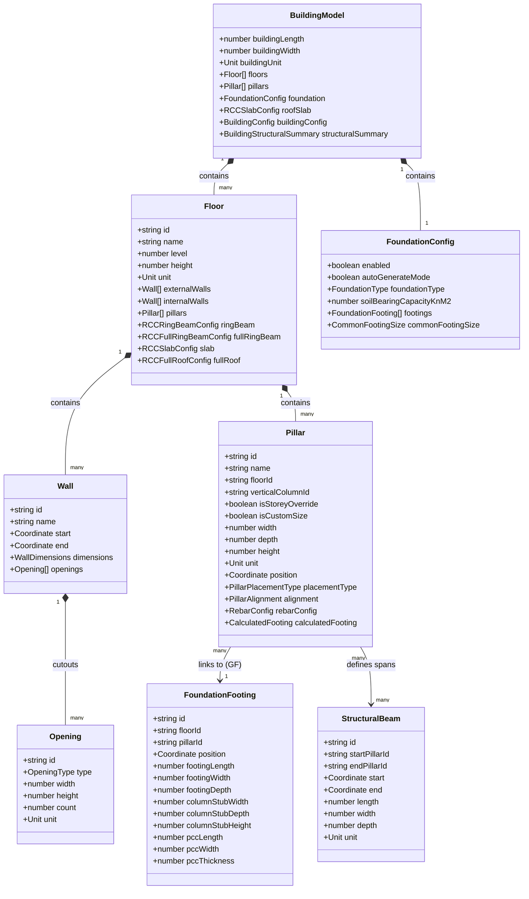

# Final Graphify Domain Model
**Document Version:** 2.0 (Post Phase B–E Implementation)  
**Project:** Brick Factory (CAD, 3D WebGL & Structural Estimation System)  
**Knowledge Graph Snapshot:** 889 Nodes · 1795 Edges · 60 Communities · Commit `238eabe2`  
**Date:** 2026-11-14

---

## 1. Domain Model Overview

The Brick Factory domain model defines a comprehensive BIM (Building Information Modeling) architecture for low-rise and mid-rise RCC (Reinforced Cement Concrete) framed buildings. It maps physical civil engineering structural entities into TypeScript domain models, mathematical estimation services, interactive 2D SVG CAD editors, and real-time Three.js 3D WebGL viewports.

---

## 2. Core Entities & Relationships

---

## 3. Detailed Entity Contracts

### 3.1 `Pillar`
The central structural entity representing vertical RCC columns.
- **`verticalColumnId`**: Identifies a continuous vertical structural column shaft extending from footing level through all storeys to roof level.
- **`isStoreyOverride`**: Optional boolean (`boolean | undefined`). When `true`, this storey's pillar dimensions and properties are decoupled from the ground shaft master. When `false` or omitted, resizing the ground floor updates continuous shafts automatically.
- **`isCustomSize`**: When `true`, preserves user-defined column dimensions against automated IS 456 preliminary resizing algorithms.
- **`placementType` & `alignment`**: Controls edge/corner alignment (`inside`, `center`, `outside`, `flush-exterior`) with `customOffsetX` and `customOffsetY`.
- **`calculatedFooting`**: Embedded dynamic geotechnical sizing metrics ($L_f, W_f, D_f, A_{\text{req}}, P_{\text{service}}$) synchronized with the linked foundation footing.

### 3.2 `StructuralBeam`
Represents linear structural RCC framing elements connecting adjacent columns.
- **Generated dynamically** by `detectPillarToPillarBeams()` along structural column grid lines.
- Endpoints align with pillar effective positions ($X_{\text{eff}}, Y_{\text{eff}}$), preserving exact orthogonal orientation (`horizontal` or `vertical`).
- Directly consumed by `calculateRingBeamsRcc()`, `structuralCalculationService`, and 2D CAD SVG rendering in `BuildingEditor.tsx`.

### 3.3 `FoundationFooting` & `FoundationConfig`
Subgrade geotechnical support system.
- One footing per ground-floor pillar, dynamically synthesized from ground pillars when `footings: []`.
- **Layer hierarchy (top to bottom)**:
  1. Column stub / pedestal ($H_{\text{stub}} = 2\text{ ft}$, cross-section matching ground column).
  2. RCC Footing ($L_f \times W_f \times D_f$, M20 grade concrete, 2-way rebar mesh with $90^\circ$ upward end hooks).
  3. PCC leveling bed ($1:4:8$ lean concrete, projecting $0.5\text{ ft}$ beyond footing edges).
  4. Sand filling cushion bed ($0.5\text{ ft}$ compacted sand).
  5. Excavation pit ($0.5\text{ ft}$ working space around PCC).
- Invariant: $\text{totalFootingRccVolumeM3} = \text{totalRccFootingVolumeM3} + \text{totalStubVolumeM3}$.

### 3.4 `Floor` Slabs and Roof Slab
- **Intermediate Floors**: Calculate floor slab volume from slab dimensions or building envelope without double counting overhead beams.
- **Top Floor**: Slab is designated as `roofSlab` on the `BuildingModel` level, eliminating triple-counting of overhead concrete plates.
- **Junction Elevation**: RCC ring beam top surface matches slab top surface, with slab plate sitting flush on top of beam stem.

---

## 4. God Nodes & Structural Hubs (From Graphify)

| God Node | Edges | Role |
|---|:---:|---|
| `calculateProject()` | 47 | Master estimation and structural synthesis entry point |
| `toMeters()` | 38 | Universal dimensional conversion and unit normalization utility |
| `VisualEstimator3D()` | 29 | Real-time Three.js WebGL 3D architectural rendering engine |
| `useCalculator()` | 27 | Global application state management via `CalculatorContext` |
| `calculateBuildingStructuralSummary()` | 26 | IS 456 structural load accumulation and tributary analysis engine |
| `BuildingEditor()` | 25 | Interactive 2D CAD canvas with SVG snap-to-grid editing |
| `detectPillarToPillarBeams()` | 25 | Structural beam detection and orthogonal alignment service |
| `Pillar` | 24 | Core architectural entity anchoring vertical shaft hierarchy |

---

## 5. Architectural Invariants

1. **Orthogonal Frame Geometry**: All detected structural frame beams are strictly orthogonal ($0^\circ$ or $90^\circ$). Endpoints are locked to pillar reference centers (`refX`, `refY`).
2. **Shaft Continuity & Decoupling**: Lower-floor pillar edits synchronize continuous upper-floor shafts sharing `verticalColumnId` unless `isStoreyOverride === true`.
3. **Subgrade Isolation**: Foundations exist strictly below ground plinth level ($Y \le 0$). Upper-floor pillars never generate footings or alter ground footing dimensions.
4. **Volume De-duplication**:
   - Pillar concrete volume is deducted from intersecting masonry walls (`trimWallByPillars`).
   - Structural beam volume replaces wall-based fallback without duplicate overlay.
   - Floor slab volume is cleanly separated from linear ring beam stem volume.
   - Roof slab is calculated once per building.
5. **Deterministic Single Source of Truth**: Successive executions of `calculateProject()` on an identical building model produce identical, deterministic quantities.
