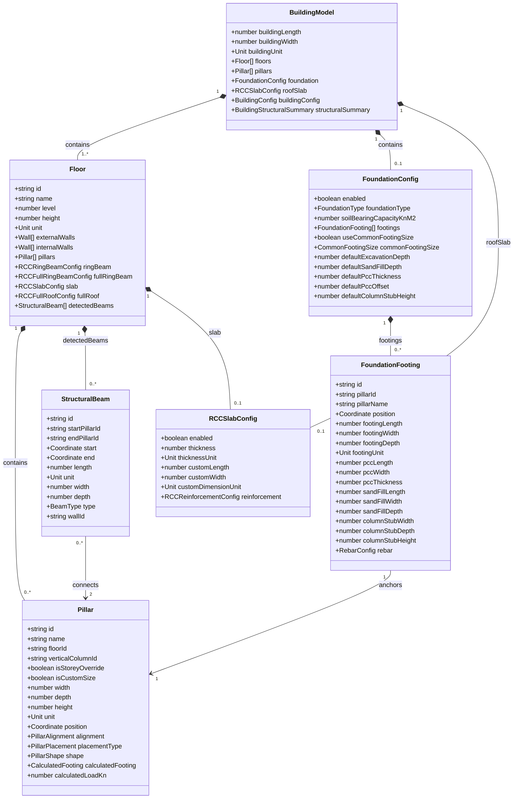

# Final Graphify Domain Model — Brick Factory Architecture

**Document Version:** 3.0 (Post Master Implementation, Automated Validation & Production Deployment)  
**Project:** Brick Factory (CAD, 3D WebGL & Structural Civil Engineering Estimation System)  
**Knowledge Graph Snapshot:** 997 Nodes · 1,939 Edges · 65 Communities · Commit `6483886e`  
**Date:** November 15, 2026  
**Auditor:** Senior Software Architect, Structural Estimation Engineer, and Graphify Analyst  

---

## 1. Domain Model Overview

The Brick Factory domain model defines a comprehensive Building Information Modeling (BIM) architecture for low-rise and mid-rise RCC (Reinforced Cement Concrete) framed buildings. It bridges physical civil engineering structural entities into strongly typed TypeScript data models, mathematical estimation services, interactive 2D SVG CAD editors, and real-time Three.js 3D WebGL viewports.

The architecture enforces a **Single Source of Truth (SSOT)** centered on the `BuildingModel` data structure. All secondary representations—including 2D canvas overlays, 3D mesh instances, structural load distributions, and material bill of quantities (BOQ)—are derived reactively from this central model.

---

## 2. Core Entities & Structural Class Diagram



---

## 3. Subsystem Architectural Relationships

### 3.1. Pillars & Continuous Column Shafts
- **Vertical Continuity (`verticalColumnId`)**:
  - Each continuous column in a multi-storey building shares a persistent `verticalColumnId`.
  - In `BuildingEditor.tsx` and `updateModelPillars()` ([src/lib/brickCalculator.ts](file:///d:/brick-factory/src/lib/brickCalculator.ts)), resizing a ground-floor pillar automatically synchronizes the new cross-section (`width` and `depth`) across all upper floors sharing that column shaft.
  - In `VisualEstimator3D.tsx`, continuous vertical shafts are rendered without step-jogs, inheriting ground dimensions unless decoupled.
- **Storey Override Isolation (`isStoreyOverride`)**:
  - Upper-floor columns can be resized independently by setting `isStoreyOverride: true`.
  - Once overridden, the pillar is decoupled from ground-floor shaft propagation. Subsequent edits to ground-floor columns leave the upper-floor pillar unchanged.
  - In `structuralCalculationService.ts`, the structural sizing engine respects `isStoreyOverride`, preventing automated load up-sizing from clobbering intentional architectural overrides.

### 3.2. Structural Beams & Frame Span Detection
- **Reusable Beam Geometry (`getEffectiveFloorBeams()`)**:
  - Replaces fragile ad-hoc beam calculations with a centralized, reusable detector that determines beam lines along column grids and load-bearing walls.
  - Enforces strict orthogonality: horizontal beams have $\Delta y = 0$; vertical beams have $\Delta x = 0$.
- **Volume & Estimation Deduplication**:
  - In `calculateRingBeamsRcc()`, when structural pillars exist, concrete volume is computed from detected structural frame spans rather than wall perimeters.
  - Thin non-structural partition walls ($\le 4.5"$) are filtered out and excluded from beam calculations.
  - In `VisualEstimator3D.tsx`, `isWallCoveredByFrame()` suppresses duplicate exterior wall beams when structural frame beams are present, eliminating the legacy "double bubble" beam bug.

### 3.3. RCC Slabs & Roof Slabs
- **Vertical Alignment**:
  - In physical construction, RCC slabs are cast integrally with the floor beams (T-beam / L-beam action).
  - In the junction model, floor slabs are vertically centered with RCC Full Ring Beams rather than resting on top of them.
- **Multi-Floor Deduplication**:
  - Intermediate storeys calculate planar floor slabs per floor based on architectural bay enclosures.
  - Top storeys calculate an independent `roofSlab` without injecting an extra 1-foot solid concrete plate across the beam grid.

### 3.4. Foundations & Dynamic Isolated Footings
- **Dynamic Sizing (`calculateDynamicPillarFooting()`)**:
  - Dynamic sizing replaces static 4 ft dummy mocks with engineering calculations based on service loads and soil capacity:
    $$P_{\text{service}} = (N_{\text{floors}} \times P_{\text{bay}} + P_{\text{col}}) \times 1.10$$
    $$A_{\text{req}} = \frac{P_{\text{service}}}{\text{SBC}}$$
    $$L = \lceil \frac{\sqrt{A_{\text{req}}}}{0.15} \rceil \times 0.15$$
  - Sizing accounts for column cross-section aspect ratios, enforces a minimum $0.30\text{ m}$ projection beyond column faces, and rounds up in standard $150\text{ mm}$ ($0.15\text{ m}$ / 6") construction steps.
- **Column Stub Alignment**:
  - Each isolated footing dynamically aligns its concrete column stub to match the ground column cross-section and coordinate location.
  - Upper-floor storey overrides do NOT alter ground footings.
  - Footing generation is idempotent: empty foundation arrays auto-generate without creating duplicates on repeated edits.

### 3.5. 2D CAD Editor & 3D Visualization Synchronization
- **BuildingEditor (2D CAD Canvas)**:
  - Real-time SVG canvas supporting wall drawing, pillar snapping, grid snapping, and dynamic structural beam overlays (centerlines, width bands, and span dimensions).
  - Multi-floor selector allows independent floor inspection without truncating inactive floor arrays.
- **VisualEstimator3D (Three.js WebGL Viewport)**:
  - Generates 3D structural meshes: isolated footing pads, PCC sub-bases, sand filling beds, column stubs, continuous columns, structural frame beams, and slabs.
  - Supports rebar mode (X-ray rebar cages and distribution meshes) and architectural mode (solid concrete materials).

### 3.6. State Management & Serialization
- **CalculatorContext (`CalculatorState`)**:
  - Central React context holding `buildingModel`, active tab, unit mode, undo/redo history stacks, and calculated estimates.
  - Derives `structuralSummary` via `calculateBuildingStructuralSummary()` by passing detected frame beams and multi-floor pillars.
- **Save / Load Serialization**:
  - Deterministic JSON roundtrip preserves all structural properties (`isStoreyOverride`, `verticalColumnId`, `calculatedFooting`, `detectedBeams`, `foundation.footings`).

---

## 4. Graphify Module Connectivity & Dependency Flow

```mermaid
flowchart TD
    subgraph UI ["User Interface Layer"]
        Page["page.tsx"]
        CalcContext["CalculatorContext.tsx"]
        Editor["BuildingEditor.tsx (2D CAD)"]
        Viewer["VisualEstimator3D.tsx (3D WebGL)"]
        Results["VisualEstimatorResults.tsx"]
    end

    subgraph Domain ["Domain Model (SSOT)"]
        Model["BuildingModel"]
        Pillars["Pillar[] (verticalColumnId, isStoreyOverride)"]
        Beams["detectedBeams[] (getEffectiveFloorBeams)"]
        Foundations["FoundationConfig (Dynamic Footings)"]
        Slabs["RCCSlabConfig (Floor & Roof)"]
    end

    subgraph Service ["Engineering & Estimation Services"]
        CalcProj["calculateProject()"]
        CalcRcc["calculateFloorRccMaterials()"]
        CalcFooting["calculateDynamicPillarFooting()"]
        StructService["calculateBuildingStructuralSummary()"]
    end

    Page --> CalcContext
    CalcContext --> Editor
    CalcContext --> Viewer
    CalcContext --> Results

    Editor <--> Model
    Viewer <-- Model
    Results <-- CalcProj

    Model --> Pillars
    Model --> Beams
    Model --> Foundations
    Model --> Slabs

    Pillars --> StructService
    Beams --> StructService
    Pillars --> CalcFooting
    Foundations --> CalcFooting

    CalcContext --> StructService
    CalcContext --> CalcProj
    CalcProj --> CalcRcc
    CalcProj --> CalcFooting
```

---

## 5. Architectural Boundaries & Limitations

1. **Concentric Axial Loading Only**:
   - The foundation sizing module assumes vertical concentric axial loads without lateral wind, seismic, or moment transfer.
2. **Simplified Punching Shear**:
   - Pad footing depth is determined via stepped empirical load thresholds ($0.30\text{ m}$ to $0.60\text{ m}$) rather than rigorous two-way critical perimeter shear calculations.
3. **Orthogonal Grid Alignment**:
   - Beam span detection operates on orthogonal column axes. Slanted non-orthogonal beam connections fall back to load-bearing wall geometry.
4. **Desktop Browser Requirement**:
   - The interactive 2D SVG canvas and Three.js 3D WebGL viewport require modern desktop browser support with WebGL 2.0.
