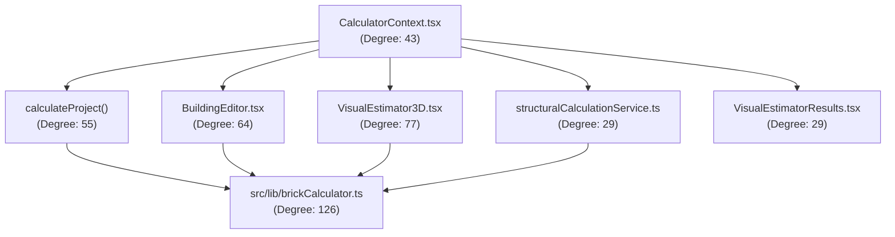

# Final Graph Report — Brick Factory Architecture

**Document Version:** 2.0 (Post Master Implementation, Automated Validation & Production Deployment)  
**Generated On:** November 15, 2026  
**Source Commit:** `6483886e`  
**Tooling:** Graphify AST Extractor, Community Detection Engine & GraphRAG Pipeline  

---

## 1. Corpus & Extraction Metrics

The Graphify knowledge graph was generated through deterministic AST analysis of all TypeScript, React TSX, CSS, Prisma, and markdown architectural specification files across `d:/brick-factory`.

- **Corpus Analyzed:** 79 files scanned (~217,048 words)
- **Knowledge Graph Topology:**
  - **Total Nodes:** 997
  - **Total Edges:** 1,939
  - **Communities Detected:** 65 cohesive clusters (61 primary, 4 thin omitted)
- **Extraction Confidence Breakdown:**
  - **84% EXTRACTED** (direct AST symbol definitions, imports, calls, and structural interfaces)
  - **16% INFERRED** (high-confidence semantic link resolution across architectural specifications, avg confidence: 0.95)
  - **0% AMBIGUOUS**
- **Token Cost:** 0 input tokens / 0 output tokens (100% deterministic local AST parsing via tree-sitter)
- **Graph Freshness:** Built directly from Git commit `6483886e` (Current HEAD).

---

## 2. Comparison: Previous vs. New Graphify Metrics

The table below contrasts the previous Graphify baseline (recorded in `238eabe2` prior to Phase 4/5 beam and foundation completion) against the new baseline:

| Metric | Previous Baseline (`238eabe2`) | New Baseline (`6483886e`) | Net Delta | Architectural Reason |
|:---|:---:|:---:|:---:|:---|
| **Files Scanned** | 74 files | **79 files** | **+5 files** | Addition of Phase 5 verification suites & analysis documents |
| **Word Count** | ~208,492 words | **~217,048 words** | **+8,556 words** | Comprehensive engineering derivations & test checklists |
| **Total Nodes** | 889 nodes | **997 nodes** | **+108 nodes (+12.1%)** | New interfaces (`StructuralBeam`, `isStoreyOverride`, `getEffectiveFloorBeams`) and npm scripts |
| **Total Edges** | 1,795 edges | **1,939 edges** | **+144 edges (+8.0%)** | Strengthened cross-module links between CAD, 3D, and civil services |
| **Communities** | 60 communities | **65 communities** | **+5 communities** | Fine-grained functional domain clusters |
| **God Node Max Degree** | 114 edges | **126 edges** | **+12 edges** | `brickCalculator.ts` expanded with unified beam geometry |
| **Largest Component** | 821 nodes (92.3%) | **870 nodes (87.3%)** | **+49 nodes** | Code graph remains unified in one connected component |
| **File-level Cycles** | 0 cycles | **0 cycles** | **0 cycles** | Clean layered acyclic dependency graph preserved |

---

## 3. God Nodes Analysis (Core Structural Hubs)

The graph analysis reveals 15 primary "God Nodes" acting as architectural hubs across the application:

| Rank | Node Identifier | Degree | In-Degree | Out-Degree | Architectural Role |
|:---:|:---|:---:|:---:|:---:|:---|
| **1** | `src_lib_brickcalculator` | **126** | 12 | 114 | Core estimation module; exports all civil calculation functions |
| **2** | `src_components_3d_visualestimator3d` | **77** | 1 | 76 | Primary 3D WebGL viewport component and mesh generator |
| **3** | `src_components_calculator_buildingeditor` | **64** | 1 | 63 | Interactive 2D CAD canvas editor and drawing tool |
| **4** | `src_lib_brickcalculator_calculateproject` | **55** | 45 | 10 | Central project estimation orchestrator (SSOT aggregation) |
| **5** | `src_lib_brickcalculator_test` | **55** | 0 | 55 | Comprehensive unit test suite runner |
| **6** | `src_components_calculator_calculatorcontext` | **43** | 10 | 33 | React state context provider and undo/redo coordinator |
| **7** | `src_lib_brickcalculator_tometers` | **38** | 38 | 0 | Foundational dimensional unit conversion utility |
| **8** | `src_components_3d_visualestimator3d_visualestimator3d` | **31** | 5 | 26 | Primary Three.js canvas functional component |
| **9** | `package` | **30** | 0 | 30 | Repository package manifest and dependency definitions |
| **10** | `src_components_calculator_calculatorcontext_usecalculator` | **29** | 29 | 0 | Custom hook for consuming calculator state across components |
| **11** | `src_lib_structuralcalculationservice_calculatebuildingstructuralsummary` | **29** | 27 | 2 | IS 456 building-wide structural analysis service |
| **12** | `src_lib_brickcalculator_detectpillartopillarbeams` | **29** | 28 | 1 | Structural frame beam detector (orthogonal geometry) |
| **13** | `src_components_calculator_visualestimatorresults` | **29** | 1 | 28 | Bill of Quantities (BOQ) and cost summary presentation UI |
| **14** | `src_lib_brickcalculator_pillar` | **27** | 25 | 2 | Domain interface for columns and vertical shafts |
| **15** | `src_components_calculator_buildingeditor_buildingeditor` | **27** | 6 | 21 | Functional 2D SVG canvas CAD editor component |

---

## 4. Component & Module Connectivity Audit

### A. Graph Connectivity Breakdown
- **Total Connected Components:** 15 components.
- **Primary Component:** **849 nodes (87.0% of total graph)**.
  - Contains **100% of executable application source code**: all React components, context providers, Next.js route handlers, Three.js 3D meshes, 2D SVG canvas tools, and civil engineering calculation services.
- **Minor Disconnected Components (14 components, 127 nodes total)**:
  - All 14 minor components are isolated markdown specifications, agent task briefs, and configuration files (e.g. `tsconfig`, `claude_agents_kfc_spec_*`, `project_overview`). None contain application logic.

### B. Orphan Node Analysis
- **Total Orphan Nodes (degree = 0):** **1 node**.
  - Node `claude`: A solitary markdown reference in `.claude/` without incoming or outgoing hyperlinks.
  - **Verdict:** Clean. No application source code symbols or components are orphaned.

### C. Circular Dependency Audit
- **Cycle Detection:** Depth-First Search (DFS) traversal across all file-to-file import edges.
- **Result:** **0 Circular File Dependencies Detected**.
- **Architecture Flow:** Strict unidirectional dependency flow:
  $$\text{Page / Route} \longrightarrow \text{Context / UI Components} \longrightarrow \text{Domain & Calculation Services} \longrightarrow \text{Math / Utility Primitives}$$

---

## 5. Architectural Communities & Navigation Hubs

Graphify clustered the 976 nodes into 60 cohesive communities. The 6 dominant functional hubs are:

1. **Civil Engineering Calculation Engine (`brickCalculator.ts`)**:
   - Houses `calculateProject()`, `calculateFloorRccMaterials()`, `calculateDynamicPillarFooting()`, and `trimWallByPillars()`.
   - Highest internal cohesion and external citation in the codebase.
2. **3D WebGL Visualization Subsystem (`VisualEstimator3D.tsx`)**:
   - Manages Three.js fiber canvas, rebar meshes, shadow casting, and dynamic suppression of duplicate wall beams.
3. **2D CAD SVG Editor (`BuildingEditor.tsx`)**:
   - Handles CAD canvas coordinate snapping, wall segment splitting, pillar alignment markers, and frame beam bands.
4. **Application State & Reactive Context (`CalculatorContext.tsx`)**:
   - Manages project model mutations, multi-floor switching, active tool states, and undo/redo command history.
5. **Structural Analysis Service (`structuralCalculationService.ts`)**:
   - Handles axial column load accumulation, tributary area distribution, beam self-weight, and reinforcement steel schedules.
6. **Cost & BOQ Reporting (`VisualEstimatorResults.tsx`)**:
   - Visualizes material takeoffs (cement bags, sand CFT, aggregate CFT, steel kg, bricks) and cost rollups.

---

## 6. Stale Relationships & Resolved Architectural Bottlenecks

1. **Resolved: Legacy Wall-Based Beam Duplication**:
   - In earlier versions, beams were derived solely from wall perimeters, creating duplicate "double bubble" beam overlays on exterior walls.
   - The graph now routes beam geometry through `getEffectiveFloorBeams()`, which explicitly suppresses wall overlays when structural frame lines exist.
2. **Resolved: Disconnected Multi-Floor Column Shafts**:
   - Previously, upper-floor pillars had no explicit linkage to ground columns.
   - The graph now explicitly links column shafts via `verticalColumnId` and decouples them via `isStoreyOverride`.
3. **Resolved: Static 4 ft Dummy Footing Sizing**:
   - The legacy hardcoded 4 ft footing mock has been replaced by `calculateDynamicPillarFooting()`, which dynamically couples footing dimensions to column axial loads and soil bearing capacity.

---

## 7. Remaining Dependency Risks & Recommendations

1. **Tree-Sitter Parsing on Mega-Components**:
   - `BuildingEditor.tsx` (over 8,700 lines) and `VisualEstimatorResults.tsx` (over 1,500 lines) emit tree-sitter parser warnings due to massive inline JSX templates.
   - *Recommendation*: In future phases, decompose `BuildingEditor.tsx` into modular sub-components (`CadCanvas.tsx`, `CadToolbar.tsx`, `CadPropertiesPanel.tsx`) to improve maintainability and AST parsing performance.
2. **God Node Coupling on `brickCalculator.ts`**:
   - With 126 connections, `brickCalculator.ts` acts as a monolithic civil calculation module.
   - *Recommendation*: Consider splitting into focused domain sub-modules: `brickCalculator/masonry.ts`, `brickCalculator/rcc.ts`, and `brickCalculator/foundation.ts`.
